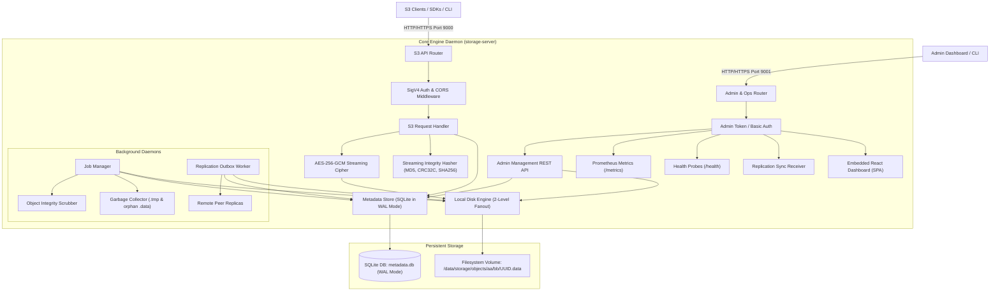
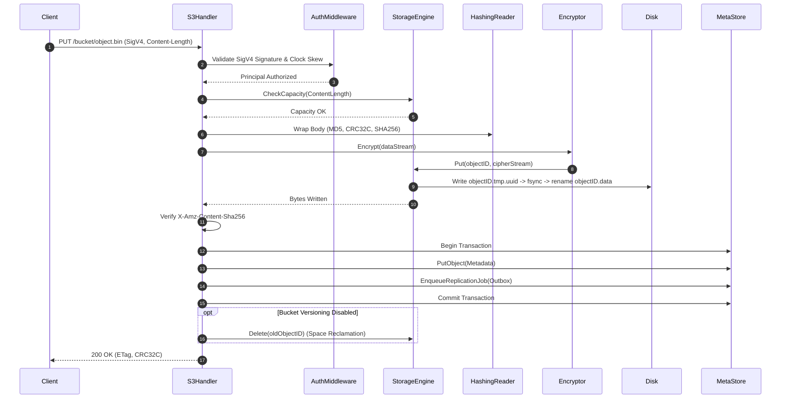

# Enterprise Architecture Specification

## 1. Executive Summary

This document specifies the internal architecture, component design, data flow, and cryptographic model of the self-hosted S3-compatible Object Storage Engine. The system is engineered in Go for bare-metal and on-premise enterprise deployments requiring high-throughput, low-latency object storage without external runtime dependencies such as MinIO or Ceph.

---

## 2. System Architecture

---

## 3. Component Breakdown

### 3.1 HTTP Server & Routing Layer (`cmd/storage-server`, `internal/s3`, `internal/api`)
- **Dual Listener Architecture**:
  - **S3 Service (Port 9000)**: Serves standard Amazon S3 REST API calls. Enforces bounded connection timeouts (`ReadHeaderTimeout: 5s`, `IdleTimeout: 120s`, `MaxHeaderBytes: 1MB`).
  - **Admin Service (Port 9001)**: Serves cluster management APIs, internal node-to-node replication synchronization, Prometheus `/metrics`, `/health` endpoints, and embedded static dashboard UI.
- **Native TLS Termination**: Optional TLS termination on both ports via `cfg.Server.TLS.CertFile` and `cfg.Server.TLS.KeyFile` without requiring an upfront reverse proxy.

### 3.2 Authentication & Authorization (`internal/auth`)
- **AWS Signature Version 4 (SigV4)**: Full implementation of HMAC-SHA256 request signing and verification for both header-based authorization (`Authorization: AWS4-HMAC-SHA256 ...`) and presigned query URLs (`X-Amz-Signature`).
- **Clock Skew Enforcement**: Enforces a strict 15-minute clock skew window (`|now - timestamp| <= 15m`). Out-of-window requests are rejected with `RequestTimeTooSkewed`.
- **Payload Hash Validation**: Validates `X-Amz-Content-Sha256` payload hashes against streaming byte checksums. Mismatched uploads are rejected with `XAmzContentSHA256Mismatch`.
- **Tenant Isolation**: S3 bucket ownership model enforces multi-tenancy. Non-admin users are strictly restricted to buckets they own.

### 3.3 Cryptographic Subsystem (`internal/encryption`, `internal/metadata`)
- **Server-Side Encryption at Rest (SSE-S3)**: Objects are encrypted using AES-256 in Galois/Counter Mode (GCM).
- **Chunked Streaming Framing**:
  - 12-byte random base nonce at file offset 0.
  - Plaintext data streamed in 64 KB chunks: `[4-byte Length][1-byte isLast][Ciphertext + 16-byte Poly1305 Tag]`.
  - Bounded allocation safety: prevents memory exhaustion panics by validating chunk lengths against maximum frame boundaries.
- **Envelope Encryption for Secrets**: User secret access keys stored in the SQLite metadata store are envelope-encrypted at rest using AES-256-GCM (`enc:v1:<base64-sealed-payload>`).

### 3.4 Filesystem Storage Engine (`internal/storage`)
- **2-Level Directory Fanout**: Objects are saved under `/data/storage/objects/aa/bb/<UUID>.data` using the first 4 characters of the object's unique identifier. This limits entries per directory to prevent filesystem inode performance collapse under millions of objects.
- **Atomic File Writes**: Upload streams are initially written to `<target>.tmp.<uuid>`. Files are fsynced to persistent media and renamed into position atomically using POSIX `rename(2)`.
- **Striped Concurrency Locking**: Replaced unbounded sync maps with a fixed 1024-element striped mutex array indexed by `fnv32a(physicalID) % 1024`, eliminating memory leaks under long uptimes.
- **Write Admission Control**: Enforces minimum free disk bytes and percentage thresholds against incoming `Content-Length`. Violations are immediately rejected with HTTP 507 `InsufficientStorage`.

### 3.5 Metadata Store (`internal/metadata`)
- **Pure-Go SQLite (`modernc.org/sqlite`)**: Zero CGO dependencies. Configured with:
  - `PRAGMA journal_mode(WAL)` for concurrent reader threads alongside a writer.
  - `PRAGMA busy_timeout(10000)` to eliminate database lock contention under load.
  - `PRAGMA foreign_keys(ON)` to preserve referential integrity.
- **Transactional Consistency**: All object creation, version pointer shifts, deletion markers, and replication outbox tasks execute within ACID database transactions.

### 3.6 Replication Engine (`internal/replication`)
- **Outbox Pattern**: Mutations generate pending records in `replication_outbox`.
- **Per-Peer Tracking**: The `replication_peer_status` table tracks delivery status, retry attempts, and errors individually for each cluster node. Prevents fast peers from starving or prematurely marking jobs completed.
- **Streaming Transfer**: Replicates physical object data directly via streaming HTTP requests with dynamic timeout floors proportional to payload size.

---

## 4. End-to-End Write Flow (PUT Object)

