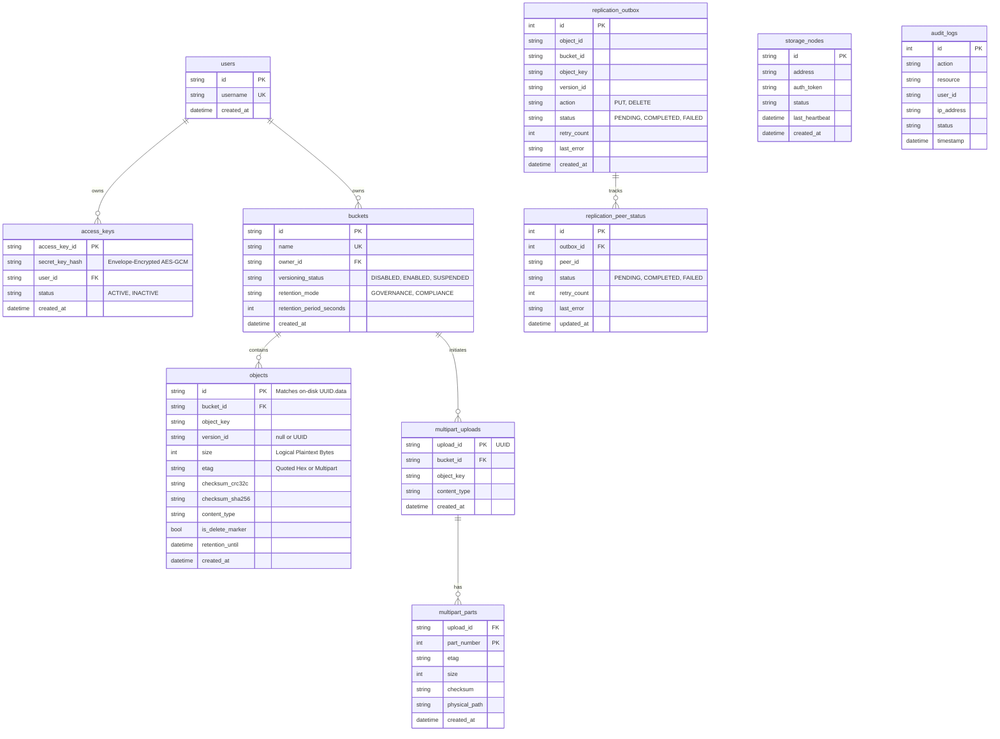

# Metadata Database Schema & Transaction Architecture

## 1. Overview

The metadata store (`internal/metadata`) manages all cluster metadata, buckets, object versions, multipart upload manifests, access credentials, cluster nodes, replication state, and audit logs. It is powered by SQLite with pure-Go driver (`modernc.org/sqlite`) configured in Write-Ahead Logging (WAL) mode.

---

## 2. Entity-Relationship Diagram (ERD)



---

## 3. Data DDL & Schema Definitions

```sql
PRAGMA busy_timeout = 10000;
PRAGMA journal_mode = WAL;
PRAGMA foreign_keys = ON;

-- Users
CREATE TABLE IF NOT EXISTS users (
    id TEXT PRIMARY KEY,
    username TEXT UNIQUE NOT NULL,
    created_at DATETIME NOT NULL
);

-- Access Credentials (Secrets Envelope-Encrypted with enc:v1: prefix)
CREATE TABLE IF NOT EXISTS access_keys (
    access_key_id TEXT PRIMARY KEY,
    secret_key_hash TEXT NOT NULL,
    user_id TEXT NOT NULL REFERENCES users(id) ON DELETE CASCADE,
    status TEXT NOT NULL,
    created_at DATETIME NOT NULL
);

-- Buckets
CREATE TABLE IF NOT EXISTS buckets (
    id TEXT PRIMARY KEY,
    name TEXT UNIQUE NOT NULL,
    owner_id TEXT NOT NULL DEFAULT 'admin-user-01',
    versioning_status TEXT NOT NULL DEFAULT 'DISABLED',
    retention_mode TEXT NOT NULL DEFAULT '',
    retention_period_seconds INTEGER NOT NULL DEFAULT 0,
    created_at DATETIME NOT NULL
);
CREATE INDEX IF NOT EXISTS idx_buckets_owner ON buckets(owner_id);

-- Objects
CREATE TABLE IF NOT EXISTS objects (
    id TEXT PRIMARY KEY,
    bucket_id TEXT NOT NULL REFERENCES buckets(id) ON DELETE CASCADE,
    object_key TEXT NOT NULL,
    version_id TEXT NOT NULL,
    size INTEGER NOT NULL,
    etag TEXT NOT NULL,
    checksum_crc32c TEXT NOT NULL,
    checksum_sha256 TEXT NOT NULL,
    content_type TEXT NOT NULL,
    is_delete_marker BOOLEAN NOT NULL DEFAULT 0,
    retention_until DATETIME,
    created_at DATETIME NOT NULL,
    UNIQUE(bucket_id, object_key, version_id)
);
CREATE INDEX IF NOT EXISTS idx_objects_lookup ON objects(bucket_id, object_key, version_id);
CREATE INDEX IF NOT EXISTS idx_objects_list ON objects(bucket_id, object_key ASC, created_at DESC);

-- Multipart Uploads
CREATE TABLE IF NOT EXISTS multipart_uploads (
    upload_id TEXT PRIMARY KEY,
    bucket_id TEXT NOT NULL REFERENCES buckets(id) ON DELETE CASCADE,
    object_key TEXT NOT NULL,
    content_type TEXT NOT NULL,
    created_at DATETIME NOT NULL
);

CREATE TABLE IF NOT EXISTS multipart_parts (
    upload_id TEXT NOT NULL REFERENCES multipart_uploads(upload_id) ON DELETE CASCADE,
    part_number INTEGER NOT NULL,
    etag TEXT NOT NULL,
    size INTEGER NOT NULL,
    checksum TEXT NOT NULL,
    physical_path TEXT NOT NULL,
    created_at DATETIME NOT NULL,
    PRIMARY KEY(upload_id, part_number)
);

-- Replication Outbox & Multi-Peer Status
CREATE TABLE IF NOT EXISTS replication_outbox (
    id INTEGER PRIMARY KEY AUTOINCREMENT,
    object_id TEXT NOT NULL,
    bucket_id TEXT NOT NULL,
    object_key TEXT NOT NULL,
    version_id TEXT NOT NULL,
    action TEXT NOT NULL,
    status TEXT NOT NULL,
    retry_count INTEGER NOT NULL DEFAULT 0,
    last_error TEXT NOT NULL DEFAULT '',
    created_at DATETIME NOT NULL
);
CREATE INDEX IF NOT EXISTS idx_outbox_status ON replication_outbox(status, created_at ASC);

CREATE TABLE IF NOT EXISTS replication_peer_status (
    id INTEGER PRIMARY KEY AUTOINCREMENT,
    outbox_id INTEGER NOT NULL REFERENCES replication_outbox(id) ON DELETE CASCADE,
    peer_id TEXT NOT NULL,
    status TEXT NOT NULL DEFAULT 'PENDING',
    retry_count INTEGER NOT NULL DEFAULT 0,
    last_error TEXT NOT NULL DEFAULT '',
    updated_at DATETIME NOT NULL,
    UNIQUE(outbox_id, peer_id)
);
CREATE INDEX IF NOT EXISTS idx_peer_status ON replication_peer_status(outbox_id, peer_id, status);

-- Audit Logs
CREATE TABLE IF NOT EXISTS audit_logs (
    id INTEGER PRIMARY KEY AUTOINCREMENT,
    action TEXT NOT NULL,
    resource TEXT NOT NULL,
    user_id TEXT NOT NULL,
    ip_address TEXT NOT NULL,
    status TEXT NOT NULL,
    timestamp DATETIME NOT NULL
);
CREATE INDEX IF NOT EXISTS idx_audit_time ON audit_logs(timestamp DESC);
```
