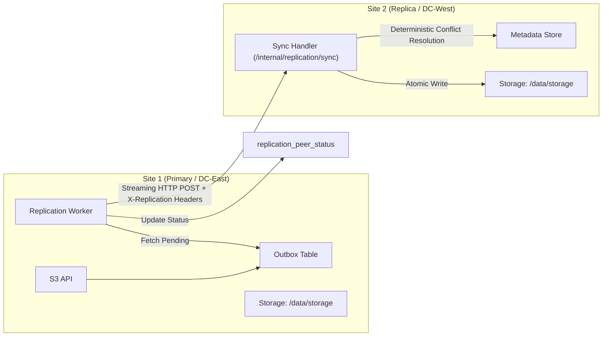
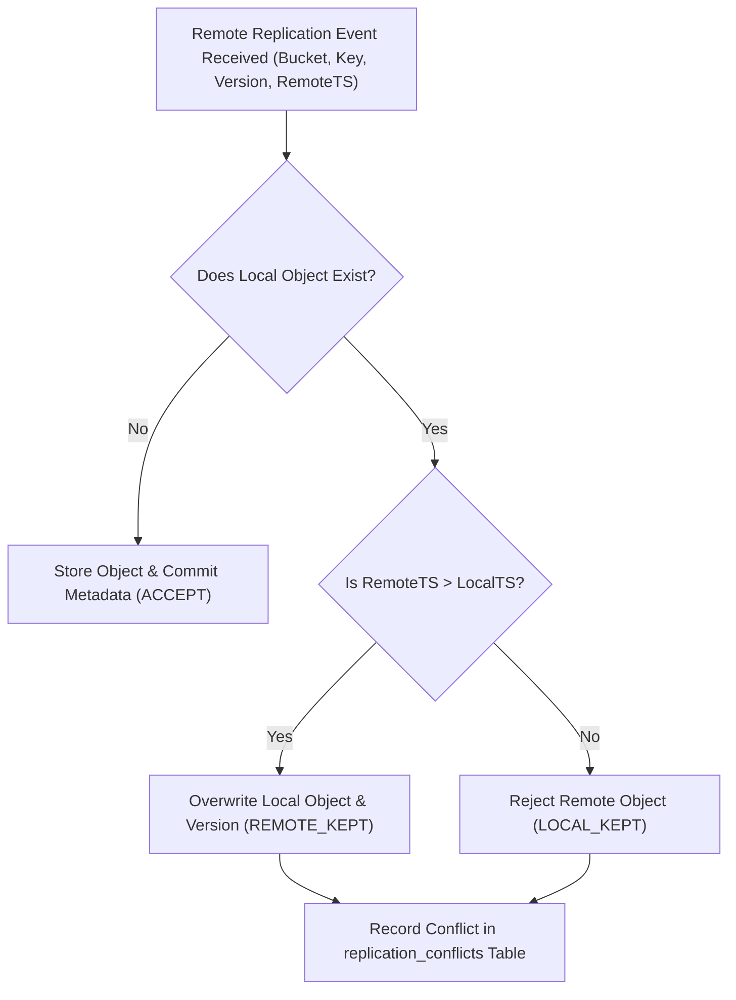

# Distributed Replication Topology & Conflict Resolution

## 1. Replication Architecture Overview

The storage engine implements an asynchronous, active-active multi-peer replication mesh designed for distributed high availability across enterprise sites, availability zones, or edge data centers.



---

## 2. Multi-Peer Independent Delivery Tracking

In multi-node topologies (e.g. 3 or more nodes: Node A, Node B, Node C), replication tasks are tracked on a per-peer basis via the `replication_peer_status` table:
1. When an object mutation occurs on Node A, a job is inserted into `replication_outbox`.
2. The background replication worker queries registered peers from `storage_nodes`.
3. For each remote peer, the worker queries:
   ```sql
   SELECT status, retry_count FROM replication_peer_status 
   WHERE outbox_id = ? AND peer_id = ?;
   ```
4. If a peer has already received the payload (`status = 'COMPLETED'`), it is skipped.
5. If Peer B is offline or network fails, its status is recorded as `FAILED` with an incremented `retry_count`, while Peer C receives the replication successfully.
6. The outbox job transitions to `COMPLETED` only after all peers have confirmed successful delivery.

---

## 3. Conflict Resolution Algorithm

In active-active multi-master systems, concurrent writes to the same bucket and object key at different sites can produce conflict anomalies. The engine resolves conflicts using deterministic **Last-Write-Wins (LWW)** governed by sub-microsecond timestamps and deletion marker precedence.



### 3.1 Conflict Resolution Rules
1. **Timestamp Precedence**:
   If an object exists locally with timestamp $T_{\text{local}}$ and an incoming replication update has $T_{\text{remote}}$:
   - If $T_{\text{remote}} > T_{\text{local}}$: Remote mutation wins. Local object is updated (`REMOTE_KEPT`).
   - If $T_{\text{remote}} < T_{\text{local}}$: Local mutation wins. Remote payload is dropped (`LOCAL_KEPT`).
2. **Versioned Objects**:
   In version-enabled buckets, both versions are preserved with their unique UUIDs, avoiding data loss entirely.
3. **Conflict Audit Trail**:
   All resolved conflicts are persisted in the `replication_conflicts` table and viewable via the Admin API (`GET /api/v1/replication/conflicts`) and Web Dashboard for operational auditing.
