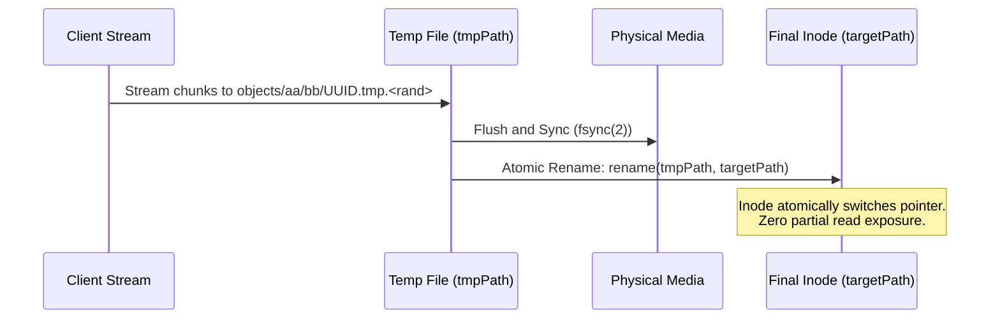

# Storage Engine Filesystem Layout & On-Disk Structures

## 1. Directory Structure

The storage engine persists all raw payload data within a structured local filesystem tree rooted at `cfg.Storage.Root` (default: `./data/storage` or `/var/lib/storage-engine/data`).

```
/data/storage/
├── objects/                       # Committed immutable object payloads
│   ├── 00/
│   │   ├── 1a/
│   │   │   └── 001a4b82-9ef8-4923-a185-d60f585a9df0.data
│   │   └── 3f/
│   │       └── 003fe981-8172-4632-9cb1-92b037e90c12.data
│   ├── e4/
│   │   └── 9c/
│   │       └── e49c8112-9844-42ea-a9ff-039c43b318aa.data
│   └── ...
└── multipart/                     # Active in-flight multipart upload chunks
    ├── 2a4066c1-bf9f-4318-b223-28da5e138a39/
    │   ├── part_1.data
    │   ├── part_2.data
    │   └── part_3.data
    └── ...
```

---

## 2. 2-Level Hashed Fanout Algorithm

### 2.1 Problem Statement
In traditional filesystems (ext4, XFS, ZFS), placing hundreds of thousands of files in a single flat directory causes significant directory index degradation, excessive directory block traversal times, and high lock contention during inode lookups.

### 2.2 Mathematical Fanout Formulation
For every newly created physical object ID (UUID v4 string), the engine extracts the first 4 hexadecimal characters:
- **Level 1 Prefix**: `physicalID[0:2]` (256 possible directories: `00` through `ff`)
- **Level 2 Prefix**: `physicalID[2:4]` (256 possible directories: `00` through `ff`)
- **Total Buckets**: $256 \times 256 = 65,536$ unique leaf directories.

$$\text{Max Files per Leaf Directory at 10M Objects} = \frac{10,000,000}{65,536} \approx 152 \text{ files per directory}$$

At 152 files per directory, all directory dentries fit cleanly within a single 4 KB filesystem block, enabling $O(1)$ constant-time inode lookups and near-zero directory metadata fragmentation.

---

## 3. Atomic Write Protocol

To prevent partial writes, corrupted files from interrupted client connections, or half-written files resulting from sudden power failures, the engine enforces strict atomic write semantics:



1. **Staging**: Incoming byte streams are written to a unique temporary sibling file:
   `/data/storage/objects/aa/bb/<UUID>.tmp.<unique-temp-id>`
2. **Persistence**: Upon receiving EOF from the client stream, `file.Sync()` (`fsync(2)`) is called to guarantee bytes are physically committed to non-volatile NAND/platter storage.
3. **Commit**: POSIX `os.Rename()` invokes `rename(2)`, atomically replacing or establishing the final `<UUID>.data` target file.
4. **Cleanup Guarantee**: A deferred cleanup function automatically unlinks `<tmpPath>` if the rename operation fails or is aborted prematurely.

---

## 4. Concurrency & Striped Mutex Locking

To ensure thread-safe operations on files without global lock bottlenecks or unbounded heap allocation leaks:
- The engine uses a fixed array of 1,024 striped mutexes: `[1024]sync.Mutex`.
- Mutex index is computed using the 32-bit Fowler-Noll-Vo hash algorithm:
  $$\text{Stripe Index} = \text{fnv32a}(\text{physicalID}) \pmod{1024}$$
- Guarantees $O(1)$ memory consumption independent of object count, while providing 1,024 concurrent independent write channels.
