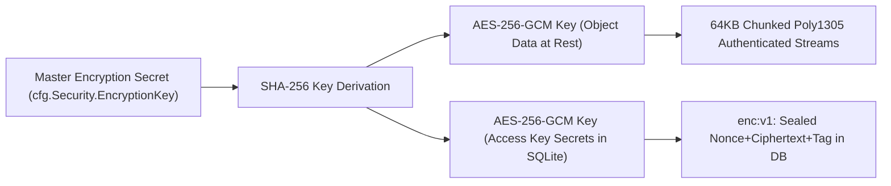

# Enterprise Security Threat Model & Security Posture (STRIDE)

## 1. Scope & Objective

This document analyzes the security architecture and threat posture of the S3-compatible Object Storage Engine using the Microsoft STRIDE methodology (Spoofing, Tampering, Repudiation, Information Disclosure, Denial of Service, Elevation of Privilege).

---

## 2. STRIDE Assessment Matrix

| Threat Category | Threat Description | Attack Vector | Mitigating Control & Code Implementation | Verification Test |
|---|---|---|---|---|
| **Spoofing** | Forged client identity or hijacked credentials | Replaying captured HTTP requests | AWS SigV4 HMAC-SHA256 signing; 15-minute clock skew window check (`|now - timestamp| <= 15m`) in `internal/auth/sigv4.go`. | `TestSigV4Verification` |
| **Spoofing** | Unauthorized peer nodes injecting replication updates | Forged node requests to `/internal/replication/sync` | Shared pre-shared key header validation (`X-Replication-Token`) matching configured cluster cluster credentials. | `TestReplicationSyncAndConflict` |
| **Tampering** | In-flight payload modification by adversary | Tampered byte stream during PUT object | `X-Amz-Content-Sha256` payload verification against computed SHA256 in `internal/s3/handler.go`. Mismatched uploads deleted immediately. | `TestHardenedProductionWorkflows` |
| **Tampering** | Ciphertext bit-flipping on storage media | Physical tampering with `.data` files on disk | Authenticated AES-256-GCM encryption with 16-byte Poly1305 tags per chunk. Automatic detection on read: returns `ErrDecryptionFailed`. | `TestAESGCMProvider` |
| **Repudiation** | Denying administrative actions or configuration changes | Admin deletes bucket or generates access key without audit trail | Synchronous structured audit logging in `internal/api/api.go` (`RecordAuditLog`) recording timestamp, user ID, IP address, action, and status. | `TestManagementAPI` |
| **Information Disclosure** | Path traversal accessing host filesystem | Malicious `uploadId` containing `../../../../etc/passwd` | Strict UUID format validation (`uuid.Parse`) and path sanitization (`validateUploadDir`) in `internal/s3/handler.go` & `internal/storage/local.go`. | `TestDeleteMultipartUploadPathTraversalProtection` |
| **Information Disclosure** | Cleartext credential leakage from database files | Compromise of backup or `metadata.db` file | Envelope encryption of access key secret hashes using AES-256-GCM (`enc:v1:...`) in `internal/metadata/sqlite.go`. | `TestAccessKeyEnvelopeEncryption` |
| **Information Disclosure** | Cleartext data sniffing over the network | Unencrypted HTTP connections | Native TLS listener configuration (`cfg.Server.TLS.Enabled`, `ListenAndServeTLS`) on both port 9000 and 9001. | Manual TLS Inspection |
| **Denial of Service** | Resource exhaustion via Slowloris connection holding | Opening connections without sending headers | Bounded HTTP server timeouts (`ReadHeaderTimeout: 5s`, `IdleTimeout: 120s`, `MaxHeaderBytes: 1MB`) in `cmd/storage-server/main.go`. | Configuration Audit |
| **Denial of Service** | Disk saturation crashing OS and database | Flooding node with large unconstrained uploads | Pre-flight admission control (`CheckCapacity`) against `Content-Length` and real-time free disk thresholds (`min_free_space_bytes`, `min_free_space_percent`). | `TestAdmissionControl` |
| **Denial of Service** | Memory exhaustion via malformed AES ciphertext | Crafting huge 4-byte chunk lengths in AES stream | Bounded chunk length check (`cipherLen <= 64KB+16 && cipherLen >= 16`) in `internal/encryption/provider.go`. | `TestAESGCMProvider` |
| **Denial of Service** | Inode starvation from millions of orphaned files | Overwritten unversioned objects retaining disk files | Immediate synchronous physical file removal on unversioned overwrite + periodic background GC sweep of unreferenced `.data` files. | `TestHardenedProductionWorkflows` |
| **Elevation of Privilege** | Anonymous developer mode gaining administrative control | Setting `auth_enabled: false` and accessing admin APIs | Non-admin isolation in `internal/auth/middleware.go`: anonymous dev principal explicitly assigned `IsAdmin: false` and `UserID: "anonymous"`. Admin API strictly protected by token. | `TestS3MultiTenantAuthorization` |
| **Elevation of Privilege** | Cross-tenant object enumeration and deletion | Tenant A reading or deleting Tenant B's objects | Multi-tenant authorization barrier in `getBucketAndAuthorize`: restricts non-admin callers strictly to buckets matching their `UserID`. | `TestS3MultiTenantAuthorization` |

---

## 3. Cryptographic Key Management & Storage Security

### 3.1 Key Lifecycle & Principles
1. **Zero Secret Key Plaintext**:
   Secret keys are never persisted in plaintext within SQLite tables. Any read via `SELECT secret_key_hash FROM access_keys` returns an encrypted hex string prefixed with `enc:v1:`.
2. **Backward Compatibility**:
   Legacy unencrypted records without the `enc:v1:` prefix are automatically parsed in plaintext without breaking migration workflows.
3. **Master Secret Separation**:
   Master keys should be injected into the daemon via environment variable `STORAGE_ENCRYPTION_KEY` or file permissions `0400` owned by the service user (`storage:storage`).
